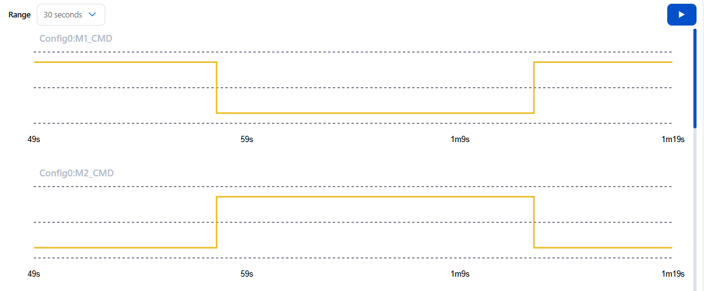
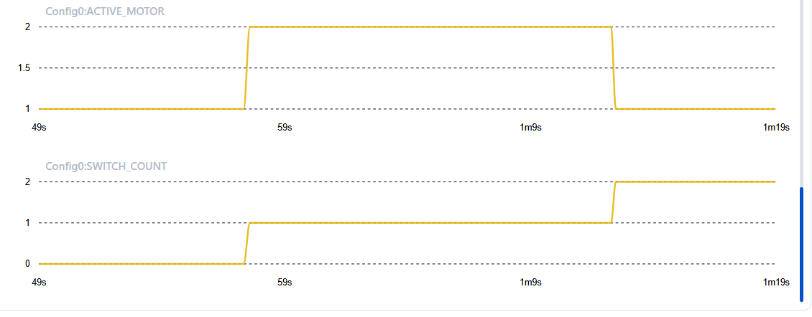

# Duty/Standby Dual-Motor Control System (OpenPLC & AutoCAD Electrical)

Industrial automation portfolio project implementing a **duty/standby control system** for two three-phase induction motors (M1 & M2) — typical of pumping stations, cooling loops, and compressor skids.

The project combines **IEC 61131-3 PLC programming** (Ladder Diagram + Structured Text in OpenPLC) with a **two-sheet electrical panel design** (400 V AC power circuit & 24 V DC PLC control wiring in AutoCAD Electrical) and full technical documentation.

📄 **[Read the Full Technical Report (PDF)](docs/PLC_Motor_Control.pdf)**  
📐 **[View Electrical Panel Schematics (PDF)](electrical_panel/Plc_motor_control.pdf)**

---

## Key Features

* **Mutual Interlocking (Software & Hardware):** Prevents simultaneous operation of M1 and M2 via PLC interlock contacts and hardwired NC auxiliary contacts (`KM1` / `KM2`).
* **Fail-Safe Input Logic:** Stop (`STOP_CMD`), Emergency Stop (`E_STOP`), and thermal overload relays (`M1_thermal`, `M2_thermal`) are wired as **Normally Closed (NC)** so a broken wire triggers a safe stop.
* - **Latched Thermal Faults & Automatic Failover:** If the duty motor trips on thermal overload, its command drops and the standby motor takes over automatically within **1–2 scan cycles (20–40 ms)** depending on rung evaluation order (`M1 → M2` in a single scan; `M2 → M1` with a 1-scan break-before-make dead-time).
* **Manual Reset with Restart Delay:** Pressing `Fault_reset` initiates a 5 s on-delay timer before clearing `Mx_FAULT`; the recovered motor returns to standby without interrupting the active motor.
* **Time-Based Duty Rotation:** Automatic wear-sharing rotation between M1 and M2 (15 s demonstration interval), blocked automatically if the standby motor is faulted.
* **Runtime & Switch Tracking (Structured Text):** Dedicated ST POU (`switch_counter`) tracks active motor state, counts valid duty transitions (ignoring initial startup and scan-cycle dead-times), and accumulates runtime in seconds (`DINT`).

---

## System Architecture & Repository Structure

Two POUs execute sequentially within a single **20 ms cyclic task**:

1. **`main` (Ladder Diagram):** Start/stop latching, safety interlocks, latched fault logic, reset timers, and duty rotation.
2. **`switch_counter` (Structured Text):** Active motor detection, edge-filtered switch counter, and 1 s runtime accumulators.

```text
duty-standby-motor-control-plc/
├── README.md
├── .gitignore
├── project.json                   # OpenPLC Editor project configuration
├── pous/                          # IEC 61131-3 POUs (main Ladder & switch_counter ST)
├── devices/                       # Hardware & resource configuration
├── docs/
│   └── PLC_Motor_Control.pdf   # Full technical report (LaTeX)
├── electrical_panel/
│   ├── Plc_motor_control.pdf      # Exported schematics (Power & Control)
│   ├── Plc_motor_control.wdp      # AutoCAD Electrical project file
│   └── *.dwg                      # Power & Control schematic drawings
└── media/
    ├── cmds.png                   # Motor command simulation traces
    └── active_sw.png              # Active motor & switch counter traces
```

---

## I/O Allocation

### Digital Inputs (`24 V DC`)
| Tag | Description | Field Device | Contact | Terminal |
| :--- | :--- | :--- | :---: | :---: |
| `START_CMD` | System start | Push button S1 | NO | `I/0` |
| `STOP_CMD` | System stop (`TRUE` = normal) | Push button S2 | NC | `I/1` |
| `Fault_reset` | Manual fault reset | Push button S3 | NO | `I/2` |
| `M1_thermal` | Motor 1 overload relay (`TRUE` = OK) | F1 aux contact | NC | `I/3` |
| `M2_thermal` | Motor 2 overload relay (`TRUE` = OK) | F2 aux contact | NC | `I/4` |
| `E_STOP` | Emergency stop (`TRUE` = normal) | Push button S4 | NC | `I/5` |

### Digital Outputs (Relay Outputs)
| Tag | Description | Field Device | Terminal |
| :--- | :--- | :--- | :---: |
| `M1_CMD` | Contactor 1 command | Coil KM1 (`24 V DC`) | `D/0` |
| `M2_CMD` | Contactor 2 command | Coil KM2 (`24 V DC`) | `D/1` |
| `ALARM_LAMP` | Fault indication | Red lamp H1 | `D/2` |
| `RUN_LAMP` | System running | Green lamp H2 | `D/3` |

---

## How to Run

1. Open the project folder in OpenPLC Editor and run it on the OpenPLC Simulator target.
2. Force `STOP_CMD`, `E_STOP`, `M1_thermal` and `M2_thermal` to `TRUE`. They are NC devices (TRUE = healthy), so they default to FALSE in the simulator and the system will not start otherwise.
3. Force `START_CMD` to `TRUE` briefly. M1 starts and M2 stays in standby.
4. Try a thermal failover (`M1_thermal` to `FALSE`), a reset (`M1_thermal` to `TRUE`, then pulse `Fault_reset`; the fault clears after 5 s), or wait for the 15 s rotation.

---

## Simulation & Verification

All operating scenarios (healthy start, thermal failover, 5 s fault reset, double fault lockout, E-Stop latching, and time-based rotation with standby fault blocking) were verified in the **OpenPLC Simulator**.

### Duty Rotation Waveforms ($M1 \rightarrow M2 \rightarrow M1$)



---

## Author

**Dimitrios Papatheodorou** — Electrical & Computer Engineering Student  
- LinkedIn: [dimitris-papatheodorou-a07b0a32a](https://www.linkedin.com/in/dimitris-papatheodorou-a07b0a32a)
